<div align="center">



# wifi_dump.sh

**A single-file Bash tool that recovers saved Wi-Fi passwords from the machine it runs on.**

[](LICENSE)
[](https://www.gnu.org/software/bash/)
[](#requirements)
[](CHANGELOG.md)

No dependencies to install. No Python, no external packages — just Bash and the tools your OS already ships with.

</div>

---

## Contents

- [What it does](#what-it-does)
- [Supported sources](#supported-sources)
- [Install](#install)
- [Usage](#usage)
- [Options](#options)
- [Output formats](#output-formats)
- [Security notes](#security-notes)
- [How it works](#how-it-works)
- [Requirements](#requirements)
- [FAQ](#faq)
- [Author](#author)
- [License](#license)

## What it does

Every OS that remembers a Wi-Fi network already stores its credentials somewhere on disk — in NetworkManager's connection files, in `wpa_supplicant.conf`, in `iwd`'s profile store, or in the macOS Keychain. `wifi_dump.sh` reads those existing stores directly, normalizes whatever it finds across every backend installed on the system, de-duplicates by SSID, and shows (or exports) a clean list of network name, password, security type, band, BSSID and last-connected time.

It doesn't scan the air, doesn't attack anything, and doesn't need a wordlist — it only surfaces credentials the OS has already saved for networks **this machine has previously connected to**. That's also why it needs root on Linux: the files it reads are root-only by design.

Typical uses: migrating to a new router/device, recovering a password you forgot was saved, auditing what a machine actually has stored before decommissioning it, or just inventorying your own saved networks.

## Supported sources

| Backend | OS | What's read |
|---|---|---|
| `nmcli` | Linux | Live query via NetworkManager's D-Bus API (`--show-secrets`) |
| NetworkManager files | Linux | `/etc\|/run\|/usr/lib/NetworkManager/system-connections/*.nmconnection` |
| `wpa_supplicant` | Linux | `/etc/wpa_supplicant/*.conf`, `/run/wpa_supplicant/*.conf` |
| `iwd` | Linux | `/var/lib/iwd/*.psk`, `*.8021x`, `*.open` |
| `connman` | Linux | `/var/lib/connman/*/settings` |
| Keychain | macOS | `networksetup` (preferred networks) + `security find-generic-password` |

All available backends run automatically — the tool doesn't need to be told which one applies; it merges whatever it finds.

## Install

```bash
git clone https://github.com/MS-X01/wifi-dump.git
cd wifi-dump
chmod +x wifi_dump.sh
```

No build step, no package manager. Optional: drop it on your `$PATH`.

```bash
sudo install -m 755 wifi_dump.sh /usr/local/bin/wifi-dump
```

## Usage

```bash
# interactive picker (default) — browse saved networks, reveal one at a time
sudo ./wifi_dump.sh

# dump everything straight to the terminal
sudo ./wifi_dump.sh -a

# dump everything and save it
sudo ./wifi_dump.sh -a -o wifi.txt
sudo ./wifi_dump.sh -a -o wifi.json -f json
sudo ./wifi_dump.sh -a -o wifi.csv  -f csv

# only networks whose SSID contains "home" (case-insensitive)
sudo ./wifi_dump.sh -a -g home

# see exactly which backends exist on this system, without extracting anything
sudo ./wifi_dump.sh --debug
```

macOS doesn't need `sudo` — Keychain prompts for your login password per-item instead.

## Options

| Flag | Description |
|---|---|
| `-a, --all` | Dump every saved profile at once |
| `-s, --select` | Interactive selector *(default)* |
| `-o, --output FILE` | Save results to `FILE` |
| `-f, --format {table,json,csv}` | Format used with `--output` *(default: `table`)* |
| `-g, --filter PATTERN` | Only networks whose SSID contains `PATTERN` *(case-insensitive)* |
| `--debug` | Diagnostic scan — shows which backends/paths exist, no secrets extracted |
| `--no-color` | Disable ANSI colors *(auto-off for non-tty output or `NO_COLOR`)* |
| `-q, --quiet` | Suppress banner/info messages |
| `-v, --version` | Print version and exit |
| `-h, --help` | Show help |

## Output formats

**`table`** (default) — a plain-text column dump, readable and `grep`-friendly:

```
SSID                               AUTH         PASSWORD                     BAND       LAST USED            SOURCE
----                               ----         --------                     ----       ---------            ------
HomeNetwork_5G                     WPA-PSK      ********                     5 GHz      2026-11-04 21:12     nmcli
OfficeGuest                        open         <none>                      2.4 GHz    2026-10-29 09:03     nmcli
```

**`json`** — structured, one object per network, for feeding into another script:

```json
{
  "generated": "2026-11-06T10:30:00+0330",
  "system": "Linux 6.8.0",
  "count": 1,
  "networks": [
    {
      "ssid": "HomeNetwork_5G",
      "auth": "WPA-PSK",
      "password": "********",
      "band": "5 GHz",
      "bssid": "AA:BB:CC:DD:EE:FF",
      "last_used": "2026-11-04 21:12",
      "source": "nmcli"
    }
  ]
}
```

**`csv`** — one row per network, for spreadsheets or a quick `awk`/`cut`:

```csv
ssid,auth,password,band,bssid,last_used,source
HomeNetwork_5G,WPA-PSK,********,5 GHz,AA:BB:CC:DD:EE:FF,2026-11-04 21:12,nmcli
```

## Security notes

- Any file written with `-o` is **automatically `chmod 600`'d** right after it's saved — it holds plaintext credentials, so it's readable by you only, never by group or world.
- The tool never writes to disk unless you pass `-o` — without it, output only ever goes to your terminal.
- Nothing here touches the network. It reads files/Keychain entries that already exist locally; there's no air scanning, no cracking, no wordlist.

## How it works

1. **Detect OS** and confirm the right privileges (root on Linux; Keychain prompts handle macOS).
2. **Run every applicable backend** for that OS — each one is independent and fails silently if the backend isn't installed or has nothing saved.
3. **Normalize** each result into the same shape (SSID, auth type, password, band, BSSID, timestamp, source) and **de-duplicate** by SSID so a network saved in two places only shows once.
4. **Present** it — interactively, as a full dump, or exported to a file — never touching the network itself.

## Requirements

- Bash 4+
- Linux: root, plus whichever of `nmcli`/NetworkManager, `wpa_supplicant`, `iwd`, `connman` is actually in use on your system (none are hard-required — the tool just uses what's present)
- macOS: `networksetup` and `security` (both ship with the OS)

## FAQ

**Will this work if I don't use NetworkManager?**
Yes — `nmcli` is just one of five backends it tries. A minimal install running plain `wpa_supplicant` or `iwd` is covered too.

**Why does it need root on Linux?**
Because the files and D-Bus secrets it reads (`/etc/NetworkManager/system-connections/*`, `wpa_supplicant.conf`, etc.) are root-only on a correctly configured system — that's the OS protecting them, and this tool doesn't bypass that, it just needs the same access level you'd use to edit those files yourself.

**Does it crack or brute-force anything?**
No. It only reads plaintext/obfuscated credentials the OS itself already stored after you successfully connected.

**Can I use it to recover a network I'm not the owner of?**
It only reads what's saved on the device you run it on — it has no way to read another device's store.

## Author

**Mohammad Sadra Naderi** — security researcher & full-stack developer, founder of [ZVitoX](https://github.com/MS-X01)

- GitHub: [github.com/MS-X01](https://github.com/MS-X01)
- LinkedIn: [linkedin.com/in/zvitox](https://linkedin.com/in/zvitox)
- Medium: [zvitox.medium.com](https://zvitox.medium.com)

## License

[MIT](LICENSE) — do whatever you want with it, just keep the license notice.
